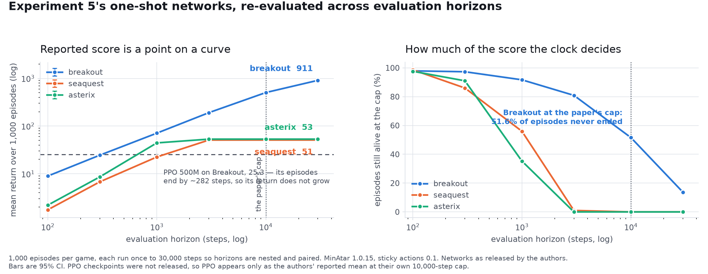

# weight-space-horizon

A preregistered re-evaluation of the three neural networks released with
[*Sparks of Weight-Space Programming*](https://rikiyat.github.io/blog/weight-space-programming/)
(Takehi, Teoh, Zhang and Khattab, MIT CSAIL, November 2026), across a ladder of evaluation
horizons.

**Result in one sentence.** A preregistered 1,000-episode re-evaluation of each released network
reproduced the authors' reported 10,000-step means within the frozen acceptance gate, but the
released Breakout network remained strongly horizon-sensitive: 51.6% of its episodes were still
running when the clock stopped them at 10,000 steps, extending the cap to 30,000 added 405.3 mean
reward, and 13.7% were still running there.



## Hypothesis

MinAtar Breakout gives +1 per brick, refills the brick rows whenever all are cleared, and terminates
only when the ball is missed — there is no internal step limit. Undiscounted return in such an
environment grows with survival time, so a reported score is partly a function of the evaluation
cap the experimenter chooses. The hypothesis is that the headline Experiment 5 comparison is
horizon-sensitive, and that the size of the reported advantage over PPO depends on where the clock
stops.

The full protocol, acceptance gate and falsifier were fixed before running anything:
[PREREGISTRATION.md](PREREGISTRATION.md).

## Method

1,000 episodes per game on MinAtar 1.0.15 with the package defaults (sticky actions 0.1, difficulty
ramping on). Each episode is run **once** to 30,000 steps and the return at horizon *C* is the
cumulative reward up to `min(termination, C)`, so every horizon is a nested, perfectly paired slice
of the same rollouts rather than an independent run.

PPO checkpoints were not part of the source release, so PPO appears only through the authors'
reported mean at their own 10,000-step cap.

## Results

### The acceptance gate passed on all three games

| game | this run | SE | published | SE | z | gate |
|---|---|---|---|---|---|---|
| breakout | 505.332 | 7.763 | 517.411 | 7.417 | −1.125 | pass |
| seaquest | 51.028 | 1.340 | 53.110 | 1.357 | −1.092 | pass |
| asterix | 53.262 | 1.081 | 53.178 | 1.023 | +0.056 | pass |

Mean episode lengths at the same cap also track: 7,190 / 7,417; 1,372 / 1,412; 856 / 858.

This reproduces the **evaluation** of three released artifacts. It does not reproduce the one-shot
generation process that produced them, and the gate is a discrepancy screen rather than a formal
equivalence test.

### Breakout across the horizon ladder

| horizon | mean return | SE | cut by the cap | pooled reward / observed step | vs PPO-500M |
|---|---|---|---|---|---|
| 100 | 8.961 | 0.010 | 97.9% | 0.089964 | ≥ 0.354 |
| 300 | 24.565 | 0.090 | 97.3% | 0.083370 | ≥ 0.969 |
| 1,000 | 71.106 | 0.508 | 91.7% | 0.074466 | ≥ 2.806 |
| 3,000 | 191.087 | 1.785 | 80.9% | 0.071229 | ≥ 7.540 |
| **10,000** | **505.332** | **7.763** | **51.6%** | **0.070286** | **19.939 (matched)** |
| 30,000 | 910.643 | 22.343 | 13.7% | 0.069955 | ≤ 35.931 |

**Only the 10,000 row is a horizon-matched comparison**, because the published PPO-500M figure
(25.344) is itself measured at a 10,000-step cap. Below that rung the capped return is divided by
PPO's reported 10,000-step mean, so each quotient is a conservative **lower bound** on the matched
ratio. Above it, PPO's mean episode length of 281.852 does not establish that no PPO episode was
alive at 10,000, so 35.931 is an **upper bound**. None of the off-rung ratios can be made matched
without the PPO checkpoints.

### The mechanism

At the matched rung the headline factorises without residue:

```
19.9389  =  25.5087          ×  0.78165
(return)    (mean observed      (pooled reward
             duration ratio)     density ratio)
```

The one-shot network is exposed 25.5× longer and earns 22% less reward per observed step. Reward
density is reported beside return, never as a replacement objective: it conditions on endogenous
episode length, and in Breakout survival creates scoring opportunity.

At a 100-step horizon the network's pooled density (0.089964) is numerically close to PPO-500M's in
its reported 10,000-step evaluation (25.344 / 281.852 = 0.089920). That is proximity across
different horizons, not an equivalence test.

### Beyond the published cap

Between 10,000 and 30,000 steps the Breakout network earns a further **405.311** mean reward
(paired SE 16.766; bootstrap 95% CI [373.9, 438.1]) — **44.5% of its own 30,000-step mean**. All 516
episodes alive at 10,000 gain more, averaging +785.5. With 13.7% still running at 30,000, even
910.643 is not a saturated lifetime return.

### Shape and scope

Return grows as **horizon^0.8785** from 100 to 10,000 (OLS on log–log; paired episode bootstrap 95%
CI [0.8724, 0.8846]; R² = 0.9995), then bends to a local exponent of 0.536 between 10,000 and
30,000. This is a descriptive fit, not a scaling law.

**The preregistered falsifier did not fire.** It was conjunctive — flattening *for all three games*
— and Breakout does not flatten.

| game | 100 → 30,000 | 3,000 → 30,000 | cut by cap beyond 3,000 | max length |
|---|---|---|---|---|
| breakout | ×101.6 | **×4.77** | 80.9% | censored at 30,000 |
| seaquest | ×29.0 | ×1.0014 | 1.0% | 3,242 |
| asterix | ×24.2 | ×1.000 | 0.0% | 2,232 |

All three returns rise steeply across the ladder. **Only Breakout remains materially sensitive
beyond 3,000.** Seaquest is close to saturated there but not saturated: its return still rises from
50.958 to 51.028 because 10 of its 1,000 episodes run past 3,000. Asterix is saturated.

### Sensitivity: difficulty ramping

`difficulty_ramping=True` is the MinAtar 1.0.15 default and is used throughout. In an
identical-seed 600-episode sensitivity check, disabling it moves the released Asterix network from
53.195 (published: 53.178) to 92.675, and Seaquest from 49.940 to 46.760. The setting is strongly
supported, though the authors' evaluator call is not published. The check uses independent-cell
standard errors and saves no episode-level differences, so it supports no paired test.
Run it with `python sensitivity_ramping.py`; output in
[`results/ramping_sensitivity.json`](results/ramping_sensitivity.json).

## Interpretation

The reported Experiment 5 numbers are correct and reproduce. What the Breakout headline measures,
however, depends on the evaluation horizon: across the ladder the advantage over PPO-500M moves
from under 1× to roughly 36×, and at the published cap more than half the episodes had not ended.
The advantage is in exposure rather than in scoring rate — the network earns slightly less reward
per observed step than PPO at every horizon measured.

In an environment with replenishing reward and termination only on failure, undiscounted return
under an administrative cap cannot separate competence from longevity. Reporting the cap, the
censoring fraction and the return-versus-horizon curve alongside the headline makes the comparison
interpretable. The authors disclosed the cap, released the networks and published the episode
lengths that this analysis uses.

### What this does not show

- Anything about the one-shot **generation** method. One network per game was released; 1,000
  episodes reduce evaluation noise for a fixed artifact and say nothing about typical behaviour,
  generation success rates, or robustness across prompts, models or replies.
- Matched-horizon PPO comparison at any rung other than 10,000.
- That reward density is the correct objective.
- That the published results are in error.

## Reproducing

```bash
pip install "minatar==1.0.15" "numpy<2" matplotlib
python fetch_data.py          # downloads the released networks, verifies sha256
python sweep.py               # 1,000 episodes x 3 games, ~8 min on 9 cores
python analyse.py             # the gate, the ladder, survival and censoring
python figure.py              # results/horizon-sweep.png
python verify_claims.py       # re-derives every number in this README from the raw records
```

Committed results were produced by this code at these checksums; `results/<game>.episodes.json`
holds the per-episode return at each horizon, the episode length and the censoring flag for all
1,000 episodes of each game, so every figure above can be recomputed without rerunning the sweep.

### A note on counting censoring

An episode is cut by the cap at horizon *h* iff it had not terminated by step *h*:

```python
cut_at(h) = censored OR length > h
```

`length >= h` miscounts episodes that ended exactly at *h*; `length > h` miscounts the top rung,
where non-terminating episodes carry `length = 30000`.

## Licence and attribution

Code in this repository is MIT. See [NOTICE.md](NOTICE.md) for attribution of the upstream networks
and evaluation data, which are fetched rather than redistributed.
