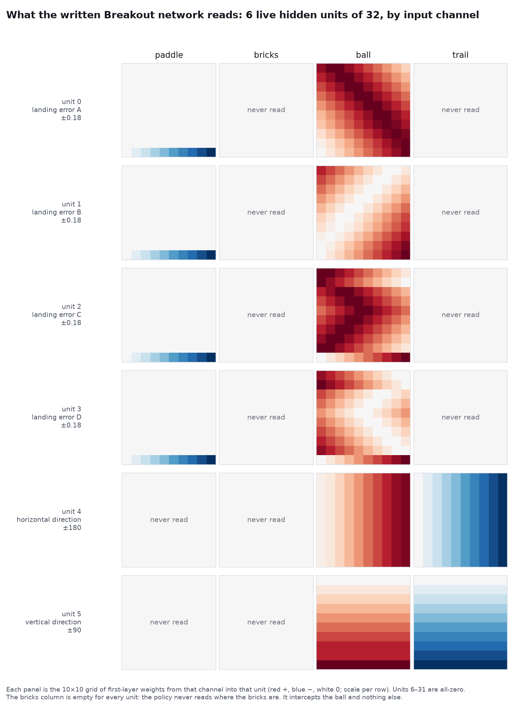

# Reading the written Breakout network

The released Breakout network from Experiment 5 (`networks/breakout/hand.npz`) has 815 non-zero
weights out of 20,486. That is small enough to read in full. This directory does so, and then
verifies the reading behaviourally against the network itself.



## The program

6 of 32 first-layer units and 8 of 32 second-layer units are live; the rest are entirely zero.

**Layer 1 — six units.**
- Units 0–3 are *landing-position errors*, one per direction quadrant (down-right, down-left,
  up-right, up-left). Preactivation = 0.02 × (predicted landing column − paddle column); the unit
  is its tanh, so it lives in ±0.18. The paddle term is an exact linear ramp of −0.02 per column,
  identical in all four. The ball term is a per-cell lookup of the predicted landing column (a zero
  weight encodes column 0).
- Units 4 and 5 are *direction heuristics* read from the ball and its trail cell, saturating; unit 4
  horizontal, unit 5 vertical. They equal MinAtar's internal direction on every diagonal move. On
  some same-row bounce frames they misreport: a second-side paddle catch (ball (8,7), trail (8,8):
  unit 4 reads −20, "left", while the ball is heading up-right) and a row-0 brick rebound (ball
  (0,2), trail (0,3): unit 5 reads +5, "down", while the ball is heading up). Under the frozen
  protocol below they match the internal direction on 99.41% of frames; all 719 exceptions are
  same-row frames of these two kinds.

**Layer 2 — four gated pairs.** Each pair is tanh(∓1000·u_m ± 200·u4 ± 200·u5 − 415): the gate
contributes +400 only in one quadrant of the direction-unit signs, and within a pair the two units
fire on opposite signs of the landing error. Threshold atanh(0.015)/0.02 = 0.750 columns: an
integer target fires when the paddle is one column off; a half-column midpoint target fires from
neither side. That is the no-op dead-band.

**Layer 3.** left = 90 + 30·Σ(even units); right = 90 + 30·Σ(odd units); no-op = 0; up, down and
fire = −100. With nothing firing, P(no-op) = 1 − 2×10⁻¹³; with one unit firing, P(that side) =
1 − 10⁻¹³.

## The landing maps are exact under the game's rules

Checked against `minatar/environments/breakout.py` `act()`: side walls clamp the ball to column 0
or 9 and flip its direction; a brick hit keeps the ball's row, advances x, and flips vertical; the
catch test fires when the ball would enter row 9 and accepts the paddle at the ball's current
column or its next column. Zero-valued cells (target column 0) are included in every count.

- **Descending units, no bricks assumed on the way down:** rows 0–5 equal the first catch column
  (the ball's column at row 8) for 60/60 cells in each unit; rows 6–8 equal the catch-interval
  midpoint for 30/30 in each (three per unit are singleton intervals where the two coincide).
- **Ascending units, a full brick band assumed:** every prospective cell in rows 1–3 holds a brick;
  bounce at the first one (keeping the row, advancing x); ignore later bricks; descend; target the
  first catch column. From rows 0–1 the top wall is reached first. 90/90 cells in each unit. Row 9
  equals the ball's own column and is never queried for another action after a miss.

`verify_landing.py`, `verify_ascending.py`, `verify_counts.py`.

## Behavioural verification

`behavioural_check.py` runs the network under the frozen horizon protocol — MinAtar 1.0.15, sticky
actions 0.1, softmax sampling with the sweep's action RNG and seeds, cap 10,000, 20 episodes — and
at every state asks a decoder built from **observations only** (ball and paddle read from the
grid, direction read from the unit-4/5 lookup) what it would do. One shared trajectory, driven by
the network's sampled action.

**121,774 states. The decoder's action equals the network's sampled action on 121,774. Zero
disagreements, zero undefined.** The 719 direction-unit exceptions are reported separately; the
decoder agrees with the network on those frames too, because both read the same heuristic. The
program description is exact; the heuristic carries the 0.6% semantic error.

**Sticky-action noise caused the pre-cap terminations.** `sticky_check.py`: on the same 200 sweep
seed pairs, sticky 0.1 terminated 97 episodes before 10,000 steps (the full sweep: 484/1,000),
whereas sticky 0 terminated none across 2,000,000 steps. Scope: this controller, this protocol,
this cap.

## What it reads, and what it does not

First-layer non-zeros by channel: paddle 36, danger 0, **brick 0**, ball 553, trail 180, gauge 0.
The network never reads the brick channel; it cannot condition its target on brick occupancy.

It does exert coarse, brick-blind control over the return direction. MinAtar's catch rule makes
the catch column an angle control: catching at the ball's current column preserves its horizontal
direction, catching at its next column reverses it. The maps target the first column early
(preserving direction) and the interval midpoint near the bottom (accepting either side) — a fixed
sweep heuristic rather than aiming at bricks it can see.

The horizon sweep found this network exposed 25.5× longer than PPO-500M at the authors' cap while
earning 22% less reward per observed step. A brick-blind interceptor that reliably catches and
sweeps is consistent with that signature. It does not causally establish it: that would need the
PPO policy's mechanism, whose checkpoints were not released.

## Faithfulness to the model's own description

The authors released the model's reply, which explains its design. Every structural claim in it
matches the tensors: four landing-position errors and two direction indicators, in the stated
quadrant order; the paddle subtraction; wall reflections in the descending predictions; the
switch to catch-interval midpoints at row 6; a full-band "earliest possible brick bounce" in the
ascending ones; four context-gated left/right pairs; no-op when positioned; and early
first-column targeting "to sweep through bricks". Its two direction-unit descriptions are accurate
for the frames they name and silent about the frames those units get wrong.

## Reproducing

```bash
python fetch_data.py                      # from the repo root, if not already done
python decode/structure.py                # every non-zero weight, by unit and channel
python decode/verify_gating.py            # layer-2 gating with realistic magnitudes
python decode/verify_landing.py           # descending maps vs the exact trajectory
python decode/verify_ascending.py         # ascending maps vs the full-band assumption
python decode/verify_counts.py            # the counts above, zero-valued cells included
python decode/behavioural_check.py 20     # the frozen-protocol agreement test
python decode/sticky_check.py             # the paired sticky-action contrast
python decode/figure_units.py             # breakout-units.png
```
